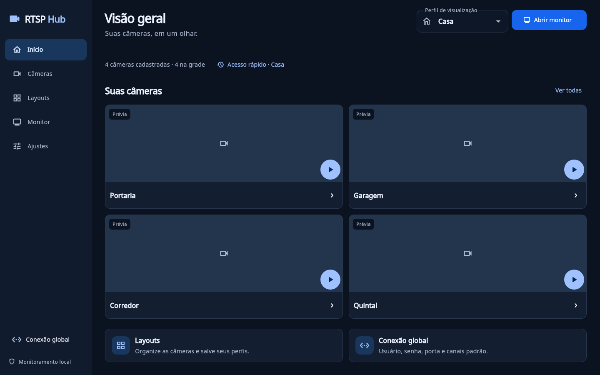
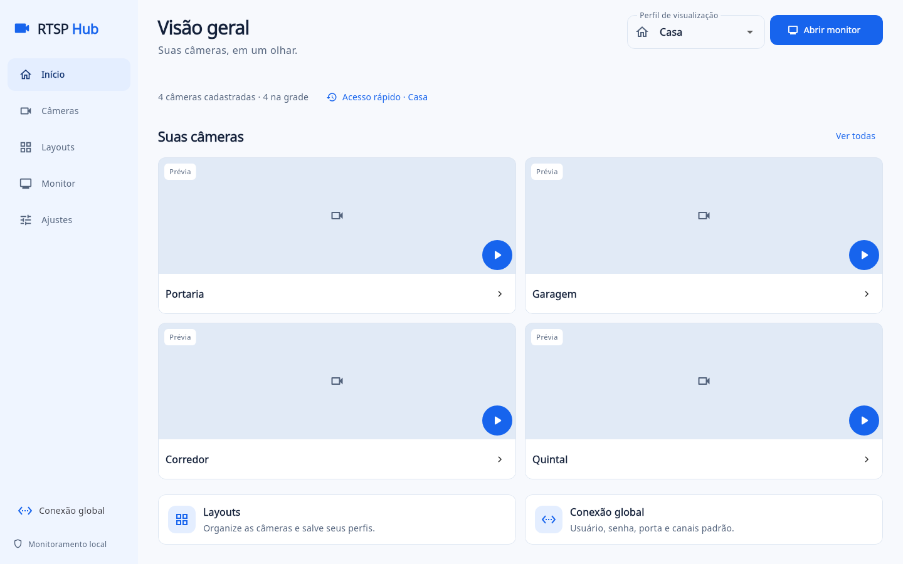
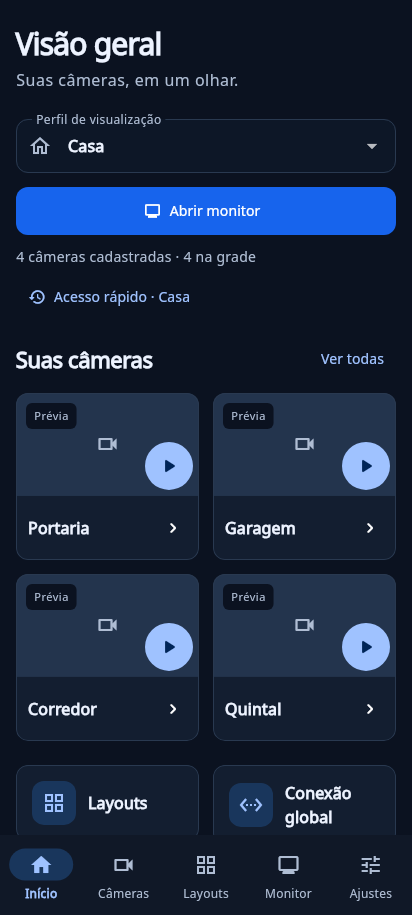
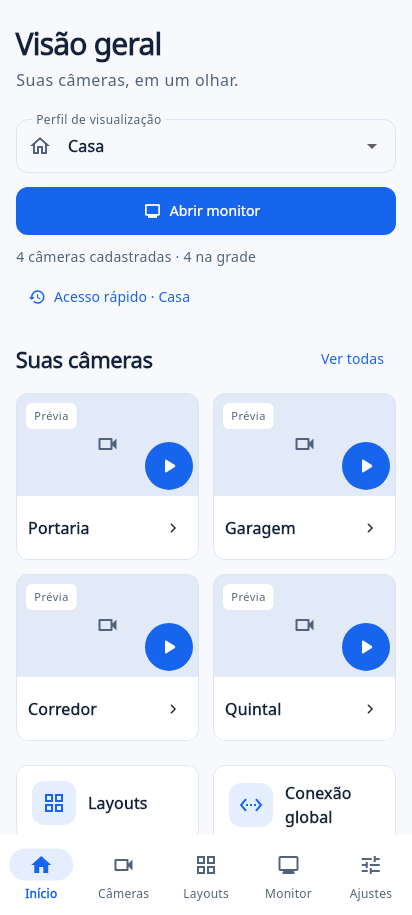

<div align="center">
  
  <h1>RTSP Hub</h1>
  <p>Visualizador local de câmeras IP e fluxos RTSP para desktop e dispositivos móveis.</p>

  <p>
    <a href="https://flutter.dev"></a>
    <a href="https://dart.dev"></a>
    <a href="https://www.linux.org"></a>
    <a href="https://www.android.com"></a>
    <a href="https://www.microsoft.com/windows"></a>
    <a href="https://mpv.io"></a>
  </p>
</div>

---

O **RTSP Hub** é um aplicativo multiplataforma criado para monitorar fluxos de câmeras de segurança diretamente na rede local, sem depender de internet, nuvem ou servidores externos. 

O mesmo APK Android também suporta **Android TV e Google TV**, com entrada no menu da TV, controle remoto e paginação configurável. A aplicação continua atendendo celulares, tablets, Linux e Windows. Veja [instalação, controles e ajustes para televisões](ANDROID_TV.md).

A reprodução usa decodificação acelerada por hardware via `libmpv`, renderizando o vídeo em texturas nativas do sistema com baixo uso de CPU e memória.

---

## Uso simples e transferência de perfis

O aplicativo inicia no monitor no **Modo Simples**. Toque numa célula para escolher a câmera e dê dois toques para ampliar ou voltar à grade. Os controles desaparecem após quatro segundos; ao tocar, aparecem os layouts rápidos 1×1, 2×2, 3×3 e 1+5. O Modo Avançado continua disponível no menu do monitor e em Ajustes, com a escolha salva neste aparelho.

Em **Câmeras → Adicionar câmera**, o assistente guia endereço, acesso/marca e teste da imagem. Os modelos de caminho são sugestões de famílias compatíveis; confirme a imagem para o seu modelo. **Abrir ajustes avançados** mantém os dados preenchidos e permite usar URL RTSP completa, caminhos e canais. O transporte e a decodificação continuam usando as políticas existentes do player.

Em **Layouts**, salve um perfil e toque no ícone de QR ao lado dele. Escolha se deseja incluir usuário e senha. Compartilhe pelo QR, copie o código compacto ou salve como `.rth` ou JSON. O destinatário usa **Importar → Ler QR Code / Abrir arquivo / Colar código**; após confirmar, o perfil abre no monitor sem apagar os perfis existentes. As câmeras com o mesmo endereço, porta e caminho são reaproveitadas e suas senhas locais são preservadas.

O formato compacto `RTH1:` usa JSON sem espaços, compressão zlib/DEFLATE, base64url e verificação SHA-256 truncada para detectar danos acidentais. Essa verificação não autentica o remetente. A versão do conteúdo dos perfis é `3`; o transporte também tem versão própria. A importação limita a descompressão a 64 MB. QR Codes acima de 1.800 caracteres oferecem transferência por código ou arquivo, para manter a leitura viável. Miniaturas não são enviadas nos perfis; o backup completo em Ajustes as inclui.

A geração de QR funciona nas plataformas do aplicativo. A leitura pela câmera usa `mobile_scanner` em Android, iOS e macOS, com permissão solicitada ao abrir o leitor. Windows e Linux recebem arquivos ou códigos colados. `qr_flutter` desenha o código; a compressão usa o Dart e o checksum usa a dependência `crypto` já existente. Não há servidor envolvido na transferência. Arquivos compartilhados em dispositivos móveis ficam no cache temporário e os antigos são removidos no próximo compartilhamento após um dia.

**Credenciais:** a opção padrão exclui usuário, senha e parâmetros comuns de autenticação nos caminhos. Revise caminhos personalizados com mecanismos proprietários antes de compartilhar. Compressão não é criptografia: quem receber uma exportação com credenciais poderá lê-las e acessar as câmeras. O cofre local continua usando `flutter_secure_storage`.

Para validar manualmente, use dois aparelhos: salve um perfil, envie com credenciais e confirme imagem/layout no destinatário; repita sem credenciais; importe um código cortado e confira a mensagem de erro. No monitor, amplie/retorne à grade, role uma grade grande e troque páginas para confirmar que só a área visível do modo simples mantém as sessões. Teste o leitor com permissão concedida, negada e após voltar do segundo plano.

## Telas do aplicativo

### Desktop (Linux e Windows)

Monitoramento em tela cheia com barras e botões recolhidos durante a reprodução:

<table>
  <thead>
    <tr>
      <th align="center">Tema escuro</th>
      <th align="center">Tema claro</th>
    </tr>
  </thead>
  <tbody>
    <tr>
      <td align="center">
        
      </td>
      <td align="center">
        
      </td>
    </tr>
  </tbody>
</table>

### Dispositivos móveis (Android)

Interface adaptada para smartphones, com quantidade de câmeras por página configurável para ajustar o consumo:

<table>
  <thead>
    <tr>
      <th align="center">Tema escuro</th>
      <th align="center">Tema claro</th>
    </tr>
  </thead>
  <tbody>
    <tr>
      <td align="center">
        
      </td>
      <td align="center">
        
      </td>
    </tr>
  </tbody>
</table>

---

## Funcionalidades principais

- **Grades flexíveis:** layouts simétricos (1x1, 2x2, 3x3, 4x4) e composições com uma câmera principal em destaque.
- **Ampliação sem recarga:** ao ampliar uma câmera e voltar à grade, as transmissões da página continuam conectadas e as superfícies de vídeo são preservadas. As câmeras ocultas deixam de ser desenhadas, suspendem animações e solicitam ao decoder que descarte somente quadros não usados como referência. A qualidade HD/SD escolhida é mantida; a economia de decodificação depende do codec e do hardware.
- **Canal principal e subfluxo:** suporta alta resolução para tela cheia e subfluxo leve para exibição simultânea na grade.
- **Descoberta de rede e ONVIF:** varredura de sub-rede para identificar portas RTSP abertas (554) e rotas de vídeo compatíveis com cancelamento instantâneo.
- **Teste prévio (Probe):** valida a decodificação da imagem e credenciais antes de salvar, gerando miniaturas com data e hora real da captura.
- **Cofre seguro:** senhas ficam protegidas nos cofres nativos de cada sistema (Secret Service no Linux, Credential Manager no Windows e Keystore no Android).
- **Reconexão automática:** monitora a saúde das transmissões e reconecta fluxos interrompidos de forma progressiva.
- **Instância única:** controle que impede a abertura de janelas duplicadas na mesma sessão no desktop.

---

## Como executar

### No Linux (Ubuntu / Debian)

Instale as bibliotecas necessárias para compilar:

```sh
sudo apt update
sudo apt install clang cmake ninja-build pkg-config libgtk-3-dev libmpv-dev libepoxy-dev libsecret-1-dev
```

Execute o projeto:

```sh
flutter pub get
flutter run -d linux
```

### No Android

Conecte o smartphone ou inicie um emulador e execute:

```sh
flutter run -d android
```

---

## Pacotes e Releases

Os instaladores finais são gerados pela automação do repositório a cada nova tag de versão:

- **Linux:** pacote `.deb` com bibliotecas de vídeo integradas (não requer instalar `libmpv` à parte).
- **Android:** aplicativo em formato `.apk` pronto para instalação.
- **Windows:** instalador `.exe` x64 com runtimes de vídeo e Visual C++ embutidos.

