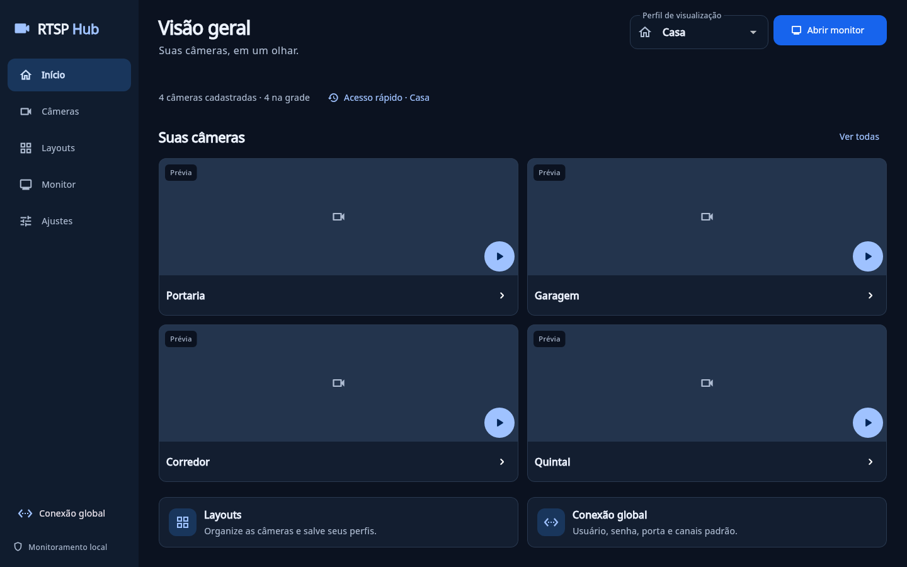
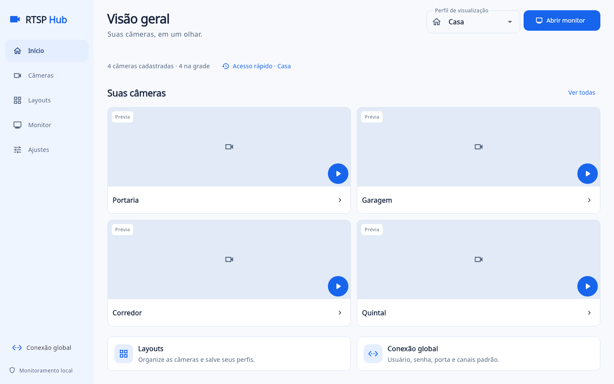
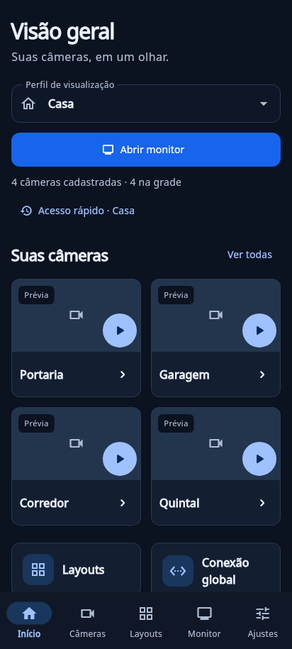
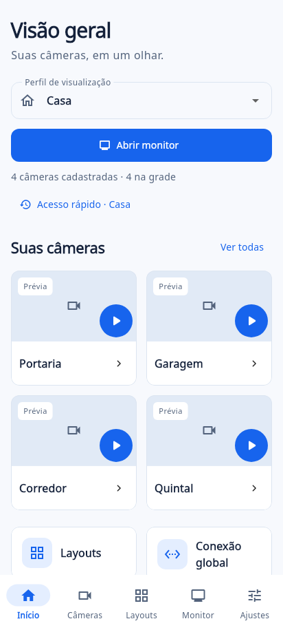

<div align="center">
  
  <h1>RTSP Hub</h1>
  <p>Visualizador local de câmeras IP e fluxos RTSP para desktop e dispositivos móveis.</p>

  <p>
    <a href="https://flutter.dev"></a>
    <a href="https://dart.dev"></a>
    <a href="https://www.linux.org"></a>
    <a href="https://www.android.com"></a>
    <a href="https://www.microsoft.com/windows"></a>
    <a href="https://mpv.io"></a>
  </p>
</div>

---

O **RTSP Hub** é um aplicativo multiplataforma criado para monitorar fluxos de câmeras de segurança diretamente na rede local, sem depender de internet, nuvem ou servidores externos. 

A reprodução usa decodificação acelerada por hardware via `libmpv`, renderizando o vídeo em texturas nativas do sistema com baixo uso de CPU e memória.

---

## Telas do aplicativo

### Desktop (Linux e Windows)

Monitoramento em tela cheia com barras e botões recolhidos durante a reprodução:

<table>
  <thead>
    <tr>
      <th align="center">Tema escuro</th>
      <th align="center">Tema claro</th>
    </tr>
  </thead>
  <tbody>
    <tr>
      <td align="center">
        
      </td>
      <td align="center">
        
      </td>
    </tr>
  </tbody>
</table>

### Dispositivos móveis (Android)

Interface adaptada para smartphones, com paginação automática para manter baixo consumo de bateria:

<table>
  <thead>
    <tr>
      <th align="center">Tema escuro</th>
      <th align="center">Tema claro</th>
    </tr>
  </thead>
  <tbody>
    <tr>
      <td align="center">
        
      </td>
      <td align="center">
        
      </td>
    </tr>
  </tbody>
</table>

---

## Funcionalidades principais

- **Grades flexíveis:** layouts simétricos (1x1, 2x2, 3x3, 4x4) e composições com uma câmera principal em destaque.
- **Modo foco com alívio de hardware:** ao ampliar uma câmera (duplo clique ou toque), os demais fluxos pausam em segundo plano para poupar processador, placa de vídeo e rede.
- **Canal principal e subfluxo:** suporta alta resolução para tela cheia e subfluxo leve para exibição simultânea na grade.
- **Descoberta de rede e ONVIF:** varredura de sub-rede para identificar portas RTSP abertas (554) e rotas de vídeo compatíveis com cancelamento instantâneo.
- **Teste prévio (Probe):** valida a decodificação da imagem e credenciais antes de salvar, gerando miniaturas com data e hora real da captura.
- **Cofre seguro:** senhas ficam protegidas nos cofres nativos de cada sistema (Secret Service no Linux, Credential Manager no Windows e Keystore no Android).
- **Reconexão automática:** monitora a saúde das transmissões e reconecta fluxos interrompidos de forma progressiva.
- **Instância única:** controle que impede a abertura de janelas duplicadas na mesma sessão no desktop.

---

## Como executar

### No Linux (Ubuntu / Debian)

Instale as bibliotecas necessárias para compilar:

```sh
sudo apt update
sudo apt install clang cmake ninja-build pkg-config libgtk-3-dev libmpv-dev libepoxy-dev libsecret-1-dev
```

Execute o projeto:

```sh
flutter pub get
flutter run -d linux
```

### No Android

Conecte o smartphone ou inicie um emulador e execute:

```sh
flutter run -d android
```

---

## Pacotes e Releases

Os instaladores finais são gerados pela automação do repositório a cada nova tag de versão:

- **Linux:** pacote `.deb` com bibliotecas de vídeo integradas (não requer instalar `libmpv` à parte).
- **Android:** aplicativo em formato `.apk` pronto para instalação.
- **Windows:** instalador `.exe` x64 com runtimes de vídeo e Visual C++ embutidos.

